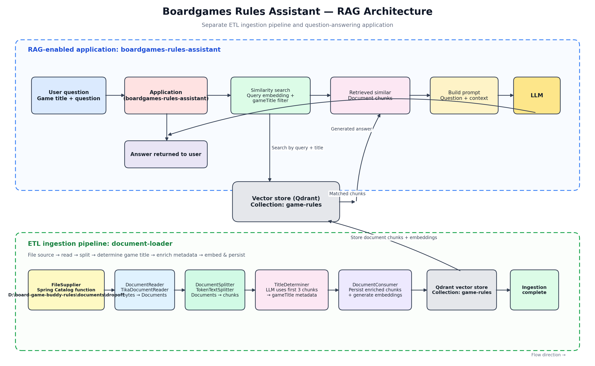
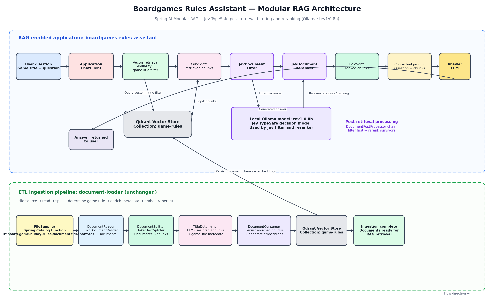

# Boardgames Rules Assistant

A Java/Spring AI learning project that answers board-game rules
questions using Retrieval-Augmented Generation (RAG). The application
retrieves relevant rulebook passages from a vector store and supplies
them as context to an LLM, helping ground answers in the source
documents.

The repository is organized around three application concepts:

1.  **RAG-enabled application** --- question answering with vector
    similarity retrieval.
2.  **ETL ingestion application** --- document ingestion, chunking,
    metadata enrichment, embedding, and persistence.
3.  **Modular RAG application** --- an enhanced RAG flow with
    post-retrieval document filtering and reranking.

> **Learning project:** This project demonstrates Spring AI and
> local-model integration. Model quality, retrieval quality, and latency
> depend on the chosen models, chunking strategy, and data.

------------------------------------------------------------------------

## High-level architecture

``` text
                 ┌──────────────────────────────────────────┐
                 │ RAG-enabled application                  │
                 │ boardgames-rules-assistant               │
User question ──▶│ Query embedding + vector retrieval       │
                 │ Retrieve rulebook chunks                 │
                 │ Build context-aware prompt               │
                 │ LLM generates grounded answer            │
                 └──────────────────┬───────────────────────┘
                                    │
                                    ▼
                           ┌──────────────────┐
                           │ Qdrant           │
                           │ game-rules       │
                           └──────────────────┘
                                    ▲
                                    │ chunks + embeddings
                 ┌──────────────────┴───────────────────────┐
                 │ ETL ingestion application                │
                 │ document-loader                           │
                 │ Discover → Read → Split → Enrich → Store │
                 └──────────────────────────────────────────┘
```

## RAG Architecture




The **Modular RAG application** uses the same ingestion data and vector
store, but adds a document post-retrieval stage:

``` text
Question (game title + question)
             │
             ▼
      Query / vector retrieval
      (gameTitle filter)
             │
             ▼
    Candidate document chunks
             │
             ▼
       Jev document filter
             │
             ▼
       Jev document reranker
             │
             ▼
     Selected, ranked documents
             │
             ▼
    Prompt with question + context
             │
             ▼
       Main answer-generation LLM
             │
             ▼
            Answer
```


## Modular-RAG Architecture



------------------------------------------------------------------------

# 1. RAG-enabled application

**Application name:** `boardgames-rules-assistant`

## Purpose

The RAG-enabled application accepts a user's board-game rules question,
retrieves relevant chunks from Qdrant, and provides those chunks to an
LLM as additional context.

For example:

-   Game title: `Burger Battle`
-   Question: "Can I play two action cards in the same turn?"

The application searches the rule chunks associated with the specified
game, builds a prompt using the question and retrieved passages, and
asks the LLM to generate an answer.

## Request flow

1.  Receive the user's **game title** and **question**.
2.  Create an embedding for the question using the configured embedding
    model.
3.  Search Qdrant for similar document chunks.
4.  Apply a metadata filter for the requested `gameTitle` so retrieval
    is scoped to the selected game.
5.  Retrieve the most relevant chunks.
6.  Add the retrieved chunks and original question to the prompt.
7.  Send the prompt to the answer-generation LLM.
8.  Return the generated answer to the user.

## RAG sequence

``` text
User
 │
 │ game title + question
 ▼
boardgames-rules-assistant
 │
 ├── Embed question
 │
 ├── Search Qdrant
 │     └── Similarity search + gameTitle filter
 │
 ├── Retrieve relevant chunks
 │
 ├── Build prompt
 │     ├── User question
 │     └── Retrieved rulebook context
 │
 ├── Call answer LLM
 │
 ▼
Answer
```

## Key components

  -----------------------------------------------------------------------
  Component                           Responsibility
  ----------------------------------- -----------------------------------
  Application / ChatClient            Coordinates the question-answering
                                      workflow

  Embedding model                     Converts the query into a vector

  Qdrant vector store                 Stores and retrieves document
                                      vectors

  Metadata filter                     Restricts retrieval to the
                                      requested game

  Prompt construction                 Combines question and retrieved
                                      context

  Chat model                          Generates the final answer
  -----------------------------------------------------------------------

## Why RAG?

The LLM does not need to rely only on its pretrained knowledge. It
receives relevant rulebook passages at query time, which can improve
answer relevance and grounding.

RAG does not guarantee correctness. Retrieval quality, document quality,
prompt design, and model behavior still matter.

------------------------------------------------------------------------

# 2. ETL ingestion application

**Application name:** `document-loader`

## Purpose

The ETL application prepares board-game rule documents for retrieval. It
runs independently from the question-answering application.

It discovers files in the configured dropoff directory, reads their
contents, splits them into chunks, determines the game title, enriches
chunk metadata, and persists the chunks and embeddings to Qdrant.

## Source directory

``` text
D:\board-game-buddy-rules\documents\dropoff
```

The source directory is configurable. The Spring Catalog function used
by `FileSupplier` discovers files from this location.

## ETL pipeline

The pipeline consists of:

``` text
fileSupplier
    |
    ▼
documentReader
    |
    ▼
documentSplitter
    |
    ▼
titleDeterminer
    |
    ▼
documentConsumer
    |
    ▼
Qdrant
```

### 2.1 FileSupplier

**Technology:** Spring Catalog function

Responsibilities:

-   Discover source files from the configured dropoff directory.
-   Supply files to the document ingestion pipeline.
-   Initiate processing for each discovered file.

### 2.2 DocumentReader

**Technology:** `TikaDocumentReader`

Responsibilities:

-   Read file bytes and extract document content using Apache Tika.
-   Convert source files into Spring AI `Document` objects.
-   Preserve relevant document metadata where available.

### 2.3 DocumentSplitter

**Technology:** `TokenTextSplitter`

Responsibilities:

-   Split extracted document content into smaller chunks.
-   Produce manageable text segments for embedding and retrieval.
-   Retain document metadata across chunks.

Chunking is important because embedding and retrieval operate on smaller
passages rather than entire rulebooks.

### 2.4 TitleDeterminer

Responsibilities:

-   Select the first three chunks from the document as context.
-   Send those chunks to an LLM.
-   Determine the board-game title represented by the document.
-   Add the detected game title as metadata to the document chunks.

Example metadata:

``` text
gameTitle = "burger_battle"
```

The `gameTitle` metadata is used by the RAG application to scope
similarity searches to a specific game.

### 2.5 DocumentConsumer

Responsibilities:

-   Receive the enriched document chunks.
-   Persist chunks and metadata to Qdrant.
-   Generate embeddings for the chunks using the configured embedding
    model.
-   Store the vector representations alongside the document content and
    metadata.

## ETL output

The ingestion pipeline writes to the Qdrant collection:

``` text
game-rules
```

Each stored record represents a document chunk and contains its text,
vector embedding, and associated metadata, including `gameTitle`.

## ETL summary

  Stage              Input                        Output
  ------------------ ---------------------------- -------------------------------
  FileSupplier       Files in dropoff directory   Discovered files
  DocumentReader     Source file bytes            Spring AI Documents
  DocumentSplitter   Documents                    Document chunks
  TitleDeterminer    First three chunks           Game title metadata
  DocumentConsumer   Enriched chunks              Chunks + embeddings in Qdrant

The ETL application is responsible for **preparing and indexing the
knowledge base**. It does not answer user questions.

------------------------------------------------------------------------

# 3. Modular RAG application

## Purpose

The Modular RAG application enhances the standard RAG retrieval process
by introducing **document filtering and reranking after vector-store
retrieval**.

Vector similarity search is useful for finding candidate passages, but
the initial result set may contain irrelevant or less useful chunks.
Modular RAG allows additional processing modules to improve the quality
and ordering of retrieved context before it reaches the
answer-generation LLM.

This implementation follows the modular post-retrieval approach
described in the Spring AI article:

[Spring AI Modular RAG: TypeSafe
Jev](https://spring.io/blog/2026/10/02/spring-ai-modular-rag-typesafe-jev)

## Main difference from basic RAG

  -----------------------------------------------------------------------
  Basic RAG                           Modular RAG
  ----------------------------------- -----------------------------------
  Retrieves similar chunks            Retrieves candidate chunks, then
                                      processes them

  Uses vector similarity results      Filters irrelevant chunks and
  directly                            reranks survivors

  Prompt uses retrieved chunks        Prompt uses selected and ranked
                                      chunks

  Simpler retrieval pipeline          More control over retrieval quality
  -----------------------------------------------------------------------

## Modular RAG flow

1.  Receive the game title and user question.
2.  Embed the question.
3.  Retrieve candidate chunks from Qdrant using similarity search and
    the `gameTitle` metadata filter.
4.  Pass the candidate chunks to the document filtering module.
5.  Filter out chunks judged irrelevant to the question.
6.  Pass the remaining chunks to the reranking module.
7.  Reorder the documents based on their relevance to the question.
8.  Use the selected, ranked documents as context in the prompt.
9.  Call the main answer-generation LLM.
10. Return the answer.

``` text
User question
     │
     ▼
Query embedding
     │
     ▼
Qdrant similarity search
(gameTitle metadata filter)
     │
     ▼
Candidate chunks
     │
     ▼
Document filtering
     │
     ├── Remove irrelevant chunks
     ▼
Document reranking
     │
     ├── Rank remaining chunks by relevance
     ▼
Selected and ranked context
     │
     ▼
Prompt augmentation
     │
     ▼
Answer-generation LLM
     │
     ▼
Final answer
```

## Jev TypeSafe decision model

**Local model:** Ollama `tev1:0.8b`

The local model is intended to act as the Jev TypeSafe decision model
for filtering and reranking.

Conceptually:

-   **Filtering:** Evaluate candidate document chunks against the
    question and determine which chunks are relevant enough to keep.
-   **Reranking:** Evaluate the remaining chunks and order them by
    relevance to the question.
-   **Final context:** Pass the selected, ranked chunks to the main
    answer-generation model.

The small local model is used for retrieval decisions rather than final
answer generation. The main chat model remains responsible for answering
the user's question.

> **Implementation note:** The Spring article describes the Jev TypeSafe
> integration. Using Ollama `tev1:0.8b` as the decision model is the
> project's local-model integration. The exact client, prompt,
> structured output, and filtering/reranking behavior depend on the
> implementation.

## Spring AI modular components

The conceptual pipeline is:

``` text
VectorStore retrieval
        │
        ▼
DocumentPostProcessor
        │
        ├── JevDocumentFilter
        │
        └── JevDocumentReranker
        │
        ▼
Prompt augmentation
        │
        ▼
Chat model
```

The post-processing modules operate on the retrieved candidate documents
before prompt augmentation. This keeps retrieval refinement separate
from final answer generation.

## Benefits

-   Reduces irrelevant context supplied to the LLM.
-   Improves ordering of candidate rulebook passages.
-   Makes retrieval refinement modular and easier to evaluate.
-   Allows the local decision model to be separate from the main answer
    model.
-   Enables experimentation with different filters, rerankers, and
    decision models.

## Trade-offs

-   Additional model calls can increase response latency.
-   Filtering may discard useful passages if the decision model is too
    strict.
-   Reranking quality depends on the model and its relevance judgments.
-   More stages mean more components to observe, test, and troubleshoot.

------------------------------------------------------------------------

# Shared configuration and data

The applications share the same Qdrant vector store for board-game
rules.

  Setting                      Value
  ---------------------------- -----------------------------------------------
  Vector store                 Qdrant
  Rules collection             `game-rules`
  Metadata key for game        `gameTitle`
  Main chat model              Ollama `llama3.2`
  Embedding model              Ollama `nomic-embed-text-v2-moe`
  Modular RAG decision model   Ollama `tev1:0.8b`
  Source directory             `D:\board-game-buddy-rules\documents\dropoff`

These are example/current project settings; configure them through
application properties for the environment in which the applications
run.

------------------------------------------------------------------------

# Running the project: suggested workflow

1.  Start Ollama and ensure the required models are available.
2.  Start Qdrant.
3.  Place board-game rule documents in the `document-loader` dropoff
    directory.
4.  Run `document-loader` to read, split, enrich, embed, and persist the
    documents.
5.  Verify that chunks and `gameTitle` metadata are present in the
    `game-rules` collection.
6.  Start `boardgames-rules-assistant`.
7.  Submit a question with a game title.
8.  For the basic RAG flow, inspect similarity retrieval and the context
    sent to the answer model.
9.  For the Modular RAG flow, inspect candidate retrieval, filter
    decisions, reranking results, and final prompt context.

------------------------------------------------------------------------

# Observability and evaluation ideas

For learning and debugging, consider logging or measuring:

-   Number of files discovered and processed.
-   Number of chunks generated per document.
-   Detected `gameTitle` and metadata consistency.
-   Embedding and Qdrant persistence duration.
-   Vector search latency and number of retrieved candidates.
-   Number of chunks before and after filtering.
-   Reranking duration and final document order.
-   Prompt/context size.
-   Main LLM response latency.
-   Answer quality against known board-game rule questions.

Compare basic RAG and Modular RAG using the same questions and source
documents. Measure retrieval relevance, answer correctness, latency, and
token usage.

------------------------------------------------------------------------

## References

-   [Spring AI --- Modular RAG, TypeSafe
    Jev](https://spring.io/blog/2026/10/02/spring-ai-modular-rag-typesafe-jev)
-   [Spring AI
    documentation](https://docs.spring.io/spring-ai/reference/)
-   [Qdrant documentation](https://qdrant.tech/documentation/)
-   [Ollama documentation](https://docs.ollama.com/)

-   [Spring AI in Action by Craig Walls]
-   [Spring AI documenation - https://docs.spring.io/spring-ai/reference/index.html]
